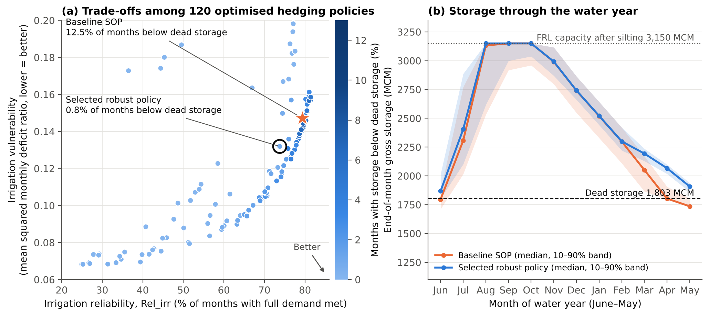
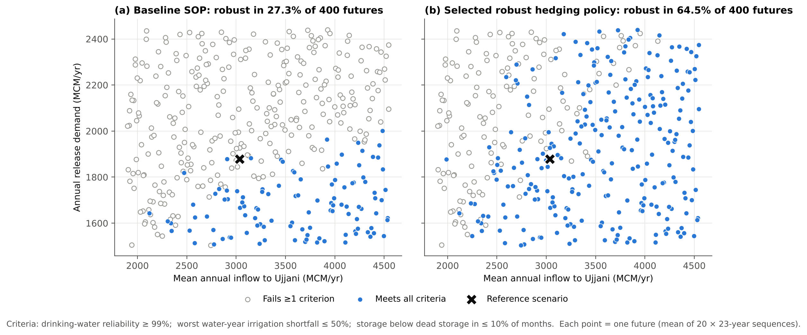

# Robust hedging policies for Ujjani Reservoir (Bhima River, Maharashtra)

Final project, watershed management. Builds on the preliminary submission (monthly mass-balance model, SOP baseline, hedging-rule lever, Hashimoto reliability measures, EMODPS with an evolutionary algorithm).

**Question.** Can a storage-dependent monthly hedging rule, optimised with Evolutionary Multi-Objective Direct Policy Search (EMODPS), balance irrigation reliability, irrigation shortfall severity and the risk of drawing Ujjani below dead storage, and how robust is it to uncertain inflow and demand?

> **Synthetic-data study.** Observed monthly storage/release for 2000–2022 could not be obtained, so inflow sequences are **synthetic**, calibrated to the CWC (2020) hydrology of Ujjani. Results show how policies behave, not a record of historical operation.

## Changes from the preliminary submission
| Item | Preliminary | Final | Reason |
|---|---|---|---|
| Inflow data | observed 2000–2022 (planned) | synthetic 23-water-year sequences (276 months) calibrated to CWC mean and 75 % dependable runoff | observed series not obtainable |
| Capacity | gross 3,320 MCM, "FRL 497.58 m" | FRL 496.83 m (497.58 m is MWL); live storage 1,347 MCM after silting | CWC (2020) sedimentation survey |
| Evaporation | pending | Hargreaves–Samani with CWC area–capacity table | area–capacity table found |
| Objectives | irrigation reliability | + squared irrigation deficit + months below dead storage | hedging always lowers time-based reliability |
| Drinking water | above dead storage only | may draw to −60 % live (silt outlets, as in 2024) | observed practice |

## Repository
```
code/ujjani_model.py        model: inflow generator, evaporation, mass balance, measures
code/optimise_policy.py     NSGA-II optimisation of the 36-parameter hedging rule
code/evaluate_policies.py   test ensemble, dry/normal/wet years, 400 uncertain futures, CART
code/make_figures.py        Figure 1 and Figure 2
code/preliminary/           scripts from the preliminary submission (unchanged except FRL label)
REFERENCES.md               all references, datasets and links
data/processed/             site parameters, area–capacity table, monthly inputs, sample synthetic inflow
results/                    Pareto policies, evaluation tables, states of the world, log
figures/                    Figure1_tradeoffs_and_storage.png, Figure2_robustness_map.png
```

## Reproduce
```
pip install -r requirements.txt
cd code
python optimise_policy.py     # ~5 min
python evaluate_policies.py   # ~7 min
python make_figures.py
```

## Key results (reference scenario, 1,000 test sequences)
| Measure | SOP baseline | Selected robust policy |
|---|---|---|
| Irrigation reliability (Q1) | 79.4 % | 73.8 % |
| Mean squared deficit ratio | 0.147 | 0.132 |
| Months below dead storage | 12.5 % | 0.8 % |
| Largest monthly shortfall, dry years | 99.9 % | 88.4 % |
| Irrigation volume delivered | 81.7 % of demand | 75.3 % of demand |
| Drinking-water reliability | 100 % | 100 % |
| Robustness (400 futures) | 27.3 % | 64.5 % |

## References
Full list with DOIs and data links: [`REFERENCES.md`](REFERENCES.md). Main references: Giuliani et al. (2016) EMODPS; Hashimoto et al. (1982) reliability, resilience, vulnerability; Deb et al. (2002) NSGA-II.

## Figures


**Figure 1.** (a) Trade-offs among 120 optimised hedging policies; (b) storage through the water year, SOP vs selected policy.



**Figure 2.** Robustness of the SOP and the selected policy across 400 uncertain futures.

## Data sources
- Central Water Commission (2020). *Sedimentation Assessment of Ujjani Reservoir, Maharashtra, through Satellite Remote Sensing.* CWC, New Delhi. Levels, storage zones, 1977 and 2017–18 elevation–area–capacity tables, mean and 75 % dependable runoff.
- Solapur climatological monthly maximum/minimum temperature (IMD station normals, as compiled by climate summary sites) for Hargreaves evaporation.
- News reports of operation (2022–2024 dead-storage drawdowns, drinking-water releases through silt outlets) for behavioural checks.

## Limitations
Synthetic inflow; upstream-regulation factor k = 0.40 is a behavioural calibration, not a fit to records; assumed demand split and canal schedule; dead-zone silting unknown; single reservoir; monthly step.
